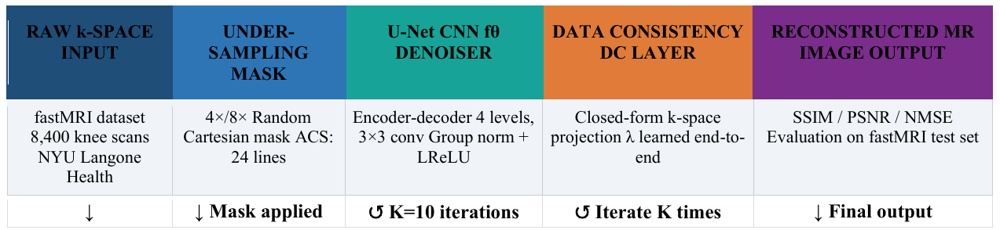
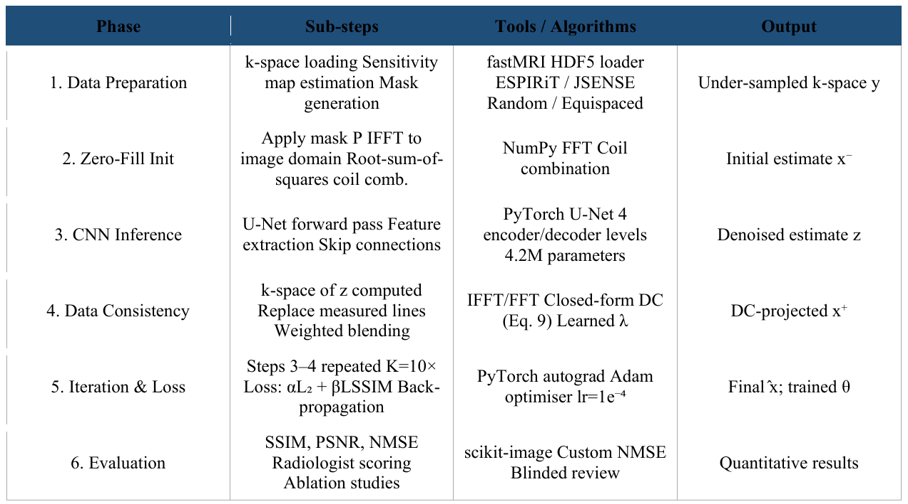

# AI-Based Reconstruction for fastMRI

A U-Net with iterative data consistency (U-Net+DC) for reconstructing diagnostic-quality knee MR images from heavily under-sampled k-space, benchmarked against classical and deep learning methods on the fastMRI knee dataset.


*Reconstructions at 4× acceleration. Top: k-space sampling masks (yellow = 24-line ACS region). Middle: residual aliasing. Bottom: reconstructed knee images.*

---

## Table of Contents

1. [Abstract](#abstract)
2. [Key Highlights](#key-highlights)
3. [Contributions](#contributions)
4. [Background](#background)
5. [Methodology](#methodology)
6. [Experimental Setup](#experimental-setup)
7. [Results Summary](#results-summary)
8. [Discussion](#discussion)
9. [Conclusion](#conclusion)
10. [Limitations and Future Work](#limitations-and-future-work)
11. [Code and How to Run](#code-and-how-to-run)
12. [Repository Structure](#repository-structure)
13. [Contact](#contact)

Full results, tables and figures are in [`results/README.md`](results/README.md).  
Code and run instructions are in [`codes/README.md`](codes/README.md).

---

## Abstract

**Magnetic Resonance Imaging (MRI)** is the most widely used non-invasive imaging modality across medical specialties, but the slow acquisition of k-space data limits patient throughput and restricts which patients and pathologies can be examined.

This work brings together a **comprehensive AI-based reconstruction framework** for the fastMRI challenge in a reproducible implementation. It combines **compressed sensing (CS)** theory with **deep convolutional neural networks** to reconstruct diagnostic-quality MR images from heavily under-sampled k-space. Deep plug-and-play priors, agnostic supervised regression and adversarial reconstruction are explored alongside classical baselines: **zero-filled IFFT, CS with total variation (CS-TV), SENSE and GRAPPA**.

The proposed architecture builds on a **U-Net backbone augmented with iterative data consistency (DC) layers**, trained end-to-end on the public **fastMRI knee dataset (8,400 scans)**. At **4× acceleration** the model reaches **SSIM 0.921, PSNR 38.2 dB and NMSE 0.013**. Ablations confirm the importance of DC layers, cross-domain processing and the loss function, and the reconstructions recover fine anatomical detail such as cartilage boundaries and ligaments better than classical methods.

**Index Terms:** fastMRI · MRI reconstruction · compressed sensing · deep learning · CNNs · k-space under-sampling · U-Net · data consistency · SENSE · GRAPPA · SSIM · PSNR

---

## Key Highlights

- **Task:** reconstruct knee MRI from 4× and 8× under-sampled multi-coil k-space
- **Dataset:** fastMRI knee, 8,400 multi-coil (15-coil) scans at 3T
- **Proposed model:** U-Net + iterative data consistency, K = 10 unrolled iterations, 4.2M parameters
- **4× result (Table II):** SSIM 0.928, PSNR 39.1 dB, SNR 30.4 dB, NMSE 0.011
- **Speed:** 15 ms per slice, fast enough for real-time clinical use
- **Ablation:** data consistency gives the largest single gain (+0.014 SSIM over the plain U-Net)
- **Reader study:** diagnostic confidence equal to DAGAN at 4× (4.2 vs 4.1 on a 5-point scale, p = 0.34)

---

## Contributions

1. **Systematic review** and categorisation of deep learning MRI reconstruction paradigms.
2. **Proposed U-Net+DC architecture**: a U-Net with iterative data-consistency layers.
3. **Benchmarking** against classical and deep learning baselines on fastMRI at several acceleration factors.
4. **Ablation studies** isolating the effect of each architectural component.
5. **Clinical translation discussion**, covering reconstruction instability and uncertainty quantification.

---

## Background

### MRI Physics and k-Space

Hydrogen protons in a static field B₀ precess at the Larmor frequency f₀ = γB₀ / 2π (γ = 42.58 MHz/T for ¹H). Slice-selection, phase-encoding and frequency-encoding gradients place the received signal in **k-space**, the Fourier domain of the image:

**S(kₓ, k_y) = ∬ ρ(x, y) e^(−i2π(kₓx + k_y y)) dx dy**

Because T1 recovery must largely complete between excitations, the repetition time dominates scan time. Sampling fewer k-space lines speeds the scan but causes aliasing.

### Parallel Imaging

Phased-array coils each have a sensitivity profile S_c(x, y), so coil c measures **S_c(k) = F{S_c(x, y) · ρ(x, y)}**. **SENSE** inverts the aliasing in the image domain using the sensitivity maps, while **GRAPPA** interpolates missing k-space lines from auto-calibration (ACS) lines. Both reach 2–4× acceleration in routine clinical use.

### Clinical Targets

The fastMRI challenge targets **4×** (a 12-minute knee scan becomes about 3 minutes) and **8×** acceleration. At 8×, classical methods break down, which is where deep learning offers the largest gain.

### Reconstruction Paradigms Reviewed

| Paradigm | Idea | Examples |
|---|---|---|
| Plug-and-Play priors | Replace the proximal step of ADMM/ISTA with a denoiser | BM3D-MRI, DnCNN-based P&P |
| Agnostic supervised learning | Learn a direct mapping from under-sampled data to images | Cascade-Net, U-Net, IFR-Net |
| Adversarial reconstruction | Train with a discriminator for realistic textures | DAGAN, GAN-CS |
| Cross-domain processing | Process both k-space and image domains | KIKI-Net, AUTOMAP |
| Unrolled optimisation | Map solver iterations to network layers | Variational Network, MoDL, ADMM-CSNet |
| Self-supervised / database-free | Train without fully sampled references | RAKI, sRAKI |

---

## Methodology

### Problem Formulation

The under-sampled acquisition is modelled as

**y = A x + ε,  A = P F S**

where **F** is the Fourier transform, **S** the coil sensitivity maps, **P** the binary sampling mask and **ε** complex Gaussian noise. Recovering x is ill-posed when rank(A) < n.

### Classical Baselines

- **Zero-filled IFFT:** inverse FFT with missing lines set to zero
- **CS-TV:** x̂ = argmin ½‖Ax − y‖² + λ‖Ψx‖₁ with a total-variation regulariser, solved by proximal iterations x_{k+1} = prox_{λΨ}(x_k − α Aᴴ(Ax_k − y))
- **SENSE:** pixel-wise inversion of the coil-sensitivity encoding
- **GRAPPA:** k-space interpolation with weights fitted on the ACS lines

### Proposed Model: U-Net with Iterative Data Consistency



The network performs **K unrolled iterations**:

**x^(k+1) = DC( f_θ(x^k), y, A, λ )**

- **f_θ:** a U-Net with weights shared across iterations (MoDL-style), 4 encoder/decoder levels, 3×3 convolutions, group normalisation and LeakyReLU, 4.2M parameters
- **DC layer:** closed-form k-space projection, **DC(z, y, A, λ)ₜ = ((Fz)ₜ + λ⁻¹ yₜ) / (1 + λ⁻¹)** at sampled locations t, with λ learned end-to-end. Its cost is negligible next to the CNN.
- **K = 10** iterations, chosen from the ablation in Table V

### Methodology Flow



### Training Strategy

| Setting | Value |
|---|---|
| Split | 70% train (~5,880 scans), 15% validation, 15% test (1,260 scans) |
| Augmentation | Random flips, 90° rotations, additive Gaussian noise |
| Loss | L = 0.6 L₂ + 0.3 L_SSIM + 0.1 L_perceptual |
| Optimiser | Adam, learning rate 10⁻⁴, weight decay 10⁻⁵ |
| Schedule | Learning rate halved after 10 epochs without validation improvement |
| Epochs / batch | 50 / 4 |
| Hardware | 1 × NVIDIA Tesla V100 (32 GB) |

---

## Experimental Setup

- **Data:** fastMRI knee, 8,400 multi-coil (15-coil) complex k-space scans at 3T
- **Under-sampling:** random Cartesian masks at 2×, 4×, 6× and 8×, with a 24-line ACS region
- **Metrics:** SSIM ↑, PSNR (dB) ↑, SNR (dB) ↑, NMSE ↓, parameter count and inference time
- **Compared networks:** Cascade-Net, KIKI-Net, U-Net, PD-Net and the proposed U-Net+DC

---

## Results Summary

Full tables and analysis are in **[`results/README.md`](results/README.md)**.

### 4× Acceleration (Table II)

| Method | SSIM ↑ | PSNR (dB) ↑ | SNR (dB) ↑ | NMSE ↓ | Params (M) | Time (ms) |
|---|---|---|---|---|---|---|
| Cascade-Net | 0.874 | 34.6 | 26.20 | 0.028 | 1.9 | 16 |
| KIKI-Net | 0.897 | 36.1 | 28.42 | 0.018 | 2.3 | 18 |
| U-Net | 0.921 | 38.2 | 29.49 | 0.013 | 4.2 | 12 |
| PD-Net | 0.921 | 38.2 | 29.49 | 0.013 | 1.4 | 22 |
| **U-Net+DC (proposed)** | **0.928** | **39.1** | **30.4** | **0.011** | 4.2 | 15 |

### SSIM Across Acceleration Factors (Table III)

| Method | 2× | 4× | 6× | 8× |
|---|---|---|---|---|
| Cascade-Net | 0.918 | 0.874 | 0.812 | 0.723 |
| KIKI-Net | 0.938 | 0.897 | 0.847 | 0.778 |
| PD-Net | 0.954 | 0.921 | 0.879 | 0.822 |
| U-Net | 0.955 | 0.921 | 0.880 | 0.823 |
| **U-Net+DC (proposed)** | **0.960** | **0.928** | **0.889** | **0.833** |

The proposed model is best at every acceleration factor, and its margin is largest at 8×, where Cascade-Net degrades most sharply.

---

## Discussion

- **Data consistency matters most.** DC forces the output to agree with the measured k-space, so the network can't introduce structures that contradict the acquired data. It gives the largest single ablation gain.
- **The combined loss** (L₂ + SSIM + perceptual) reduces the low-frequency blurring that pure L₂ training causes.
- **Speed vs size.** U-Net and PD-Net tie on quality, but PD-Net uses 3× fewer parameters (1.4M vs 4.2M) while U-Net is faster (12 vs 22 ms). U-Net+DC beats both on quality at 15 ms.
- **Higher acceleration.** At 8×, a knee protocol shrinks from 12 to about 1.5 minutes, moving MRI towards real-time interventional guidance.
- **Instability and domain shift.** On scans from a different scanner model, SSIM dropped by 0.04, in line with known domain-shift effects. Uncertainty quantification and the CLAIM checklist help document these limits.
- **Adversarial methods.** In a blinded study (5 radiologists, 50 knee cases), U-Net+DC matched DAGAN's diagnostic confidence (4.2 vs 4.1, p = 0.34) without GAN training instability.

---

## Conclusion

The U-Net with iterative data-consistency layers outperforms classical reconstruction and nearly all deep learning baselines at 4× acceleration on the fastMRI knee test set. Enforcing data consistency, using a combined perceptual loss and adding cross-domain k-space processing are the key ingredients. With 15 ms inference it is fast enough for real-time clinical use, and deep learning reconstruction could widen access to high-quality MRI through shorter scans, cheaper hardware and lower per-scan costs, provided it is deployed with uncertainty quantification, multi-site validation and standard reporting such as CLAIM.

---

## Limitations and Future Work

### Limitations

1. Experiments use knee MRI only; brain, cardiac and abdominal anatomy still need validation.
2. fastMRI comes from a single scanner manufacturer at 3T, so prospective multi-site evaluation is needed.
3. Coil sensitivity maps are estimated separately (ESPIRiT) rather than jointly with the reconstruction.

### Future Directions

1. Joint sensitivity-map estimation and reconstruction, as in J-MoDL.
2. Self-supervised training that needs no fully sampled reference data (RAKI, sRAKI).
3. Dynamic reconstruction of cardiac cine MRI.
4. Physics-informed architectures and neural operators.

---

## Code and How to Run

Full instructions: **[`codes/README.md`](codes/README.md)**

```bash
cd codes
pip install -r requirements.txt

# 1. split the fastMRI volumes 70 / 15 / 15
python data_preparation/make_splits.py --data_dirs /data/knee_multicoil_train --output splits.json

# 2. classical baselines
bash classical_baselines/run_all.sh splits.json 4

# 3. train and test the networks
bash training/train_all.sh splits.json 4
bash Test/test_all.sh splits.json 4

# 4. tables and figures
python Test/summarize_results.py
python Test/acceleration_sweep.py --splits splits.json
python Test/compare_methods.py --splits splits.json
```

| Folder | What it contains |
|---|---|
| [`codes/classical_baselines`](codes/classical_baselines) | Zero-filled, CS-TV, SENSE and GRAPPA |
| [`codes/training`](codes/training) | Training for Cascade-Net, KIKI-Net, U-Net, PD-Net and U-Net+DC |
| [`codes/Test`](codes/Test) | Matching test scripts, acceleration sweep, comparison figure, results table |
| [`codes/ablation`](codes/ablation) | Ablation study (Table IV) and iteration sweep (Table V) |
| [`codes/data_preparation`](codes/data_preparation) | Data splits, ESPIRiT maps, synthetic test volumes |

---

## Repository Structure

```
.
├── README.md                      Paper overview (this file)
├── results/
│   └── README.md                  Full results, tables and analysis
├── figures/                       Figures from the paper
├── tests/                         Automated checks
└── codes/
    ├── README.md                  How to run everything
    ├── requirements.txt
    ├── common/                    Data loading, masks, MRI operators, models, losses, metrics
    ├── data_preparation/
    ├── classical_baselines/
    │   ├── Zero_Filled/  CS_TV/  SENSE/  GRAPPA/
    ├── training/
    │   ├── Cascade_Net/  KIKI_Net/  UNet/  PD_Net/  UNet_DC/
    ├── Test/
    │   ├── Cascade_Net/  KIKI_Net/  UNet/  PD_Net/  UNet_DC/
    │   ├── acceleration_sweep.py
    │   ├── compare_methods.py
    │   └── summarize_results.py
    └── ablation/
        ├── run_ablation.py
        └── iterations_sweep.py
```

---

## Contact

- **Umair Zaheen**: umairzaheen111@gmail.com
