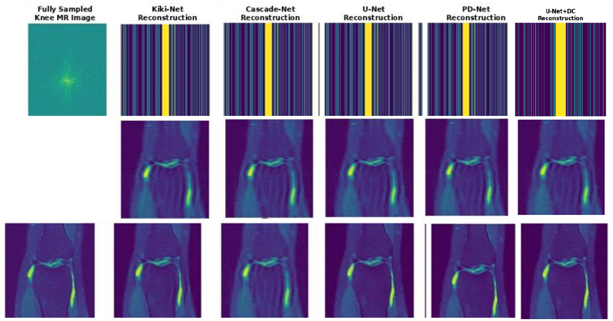

# Experimental Results and Analysis

[Back to paper overview](../README.md)

---

## Contents

1. [Dataset and Evaluation Protocol](#1-dataset-and-evaluation-protocol)
2. [Qualitative Results at 4x](#2-qualitative-results-at-4x)
3. [Quantitative Comparison at 4x](#3-quantitative-comparison-at-4x)
4. [Performance vs Acceleration Factor](#4-performance-vs-acceleration-factor)
5. [Ablation Study](#5-ablation-study)
6. [Number of Unrolled Iterations K](#6-number-of-unrolled-iterations-k)
7. [Domain Shift and Reader Study](#7-domain-shift-and-reader-study)
8. [Public MRI Datasets Reviewed](#8-public-mri-datasets-reviewed)

---

## 1. Dataset and Evaluation Protocol

| Item | Detail |
|---|---|
| Dataset | fastMRI knee, 8,400 multi-coil (15-coil) complex k-space scans at 3T |
| Split | 70% train, 15% validation, 15% test (1,260 scans) |
| Accelerations | 2×, 4×, 6×, 8× (random Cartesian masks) |
| ACS region | 24 fully sampled central lines |
| Metrics | SSIM ↑, PSNR (dB) ↑, SNR (dB) ↑, NMSE ↓, parameters, inference time |

Raw k-space lets any under-sampling pattern be simulated retrospectively, which is the standard way to evaluate reconstruction methods.

---

## 2. Qualitative Results at 4x

*Figure 3: fastMRI knee test results at 4× acceleration. Top row: k-space sampling (yellow = ACS band). Middle row: residual aliasing artefacts. Bottom row: reconstructed images. Columns: fully sampled reference, Kiki-Net, Cascade-Net, U-Net, PD-Net, U-Net+DC.*

| Method | What the reconstructions show |
|---|---|
| **Cascade-Net** | Visible blurring of the articular cartilage and meniscal horns |
| **KIKI-Net** | General knee anatomy recovered, some residual aliasing in the soft-tissue background |
| **U-Net / PD-Net** | Ghosting artefacts suppressed better than the first two baselines |
| **U-Net+DC (proposed)** | Strongest suppression of aliasing artefacts of all five methods |

---

## 3. Quantitative Comparison at 4x

**Table II: Reconstruction results at 4× acceleration on the fastMRI knee test set**

| Method | SSIM ↑ | PSNR (dB) ↑ | SNR (dB) ↑ | NMSE ↓ | Params (M) | Time (ms) | Type |
|---|---|---|---|---|---|---|---|
| Cascade-Net | 0.874 | 34.6 | 26.20 | 0.028 | 1.9 | 16 | DL |
| KIKI-Net | 0.897 | 36.1 | 28.42 | 0.018 | 2.3 | 18 | DL |
| U-Net | 0.921 | 38.2 | 29.49 | 0.013 | 4.2 | **12** | DL |
| PD-Net | 0.921 | 38.2 | 29.49 | 0.013 | **1.4** | 22 | DL |
| **U-Net+DC (proposed)** | **0.928** | **39.1** | **30.4** | **0.011** | 4.2 | 15 | DL+DC |

### Key findings

- **U-Net+DC is best on every quality metric.** NMSE 0.011 is a **15.4%** reduction against U-Net and PD-Net and a **60.7%** reduction against Cascade-Net.
- **SNR gains.** U-Net+DC is **0.91 dB** above the best baselines and **4.20 dB** above Cascade-Net. The 3.29 dB gap between Cascade-Net and U-Net/PD-Net is large, since every 3 dB roughly doubles signal power relative to noise.
- **U-Net and PD-Net tie on quality.** PD-Net needs 3× fewer parameters (1.4M vs 4.2M), while U-Net runs faster (12 vs 22 ms).
- **Accuracy and speed together.** U-Net+DC has the same parameter count as U-Net and is only 3 ms slower (15 ms), making it the only method here that combines the best accuracy with real-time inference.

---

## 4. Performance vs Acceleration Factor

**Table III: SSIM across acceleration factors (fastMRI knee test set)**

| Method | 2× SSIM | 4× SSIM | 6× SSIM | 8× SSIM |
|---|---|---|---|---|
| Cascade-Net | 0.918 | 0.874 | 0.812 | 0.723 |
| KIKI-Net | 0.938 | 0.897 | 0.847 | 0.778 |
| PD-Net | 0.954 | 0.921 | 0.879 | 0.822 |
| U-Net | 0.955 | 0.921 | 0.880 | 0.823 |
| **U-Net+DC (proposed)** | **0.960** | **0.928** | **0.889** | **0.833** |

- Classical methods stay competitive at 2× but fall away beyond 4×. At 8×, zero-filled IFFT reaches SSIM 0.408 and GRAPPA 0.625.
- **Cascade-Net** drops most steeply at 8× (0.723), so it tolerates high under-sampling poorly.
- **U-Net+DC** leads at every factor. At 8× a standard knee protocol shrinks from 12 to about 1.5 minutes.

---

## 5. Ablation Study

**Table IV: Ablation on the fastMRI knee test set at 4× acceleration**

| Configuration | DC | K-Domain | Combined Loss | SSIM ↑ | PSNR (dB) ↑ | NMSE ↓ | Time (ms) |
|---|---|---|---|---|---|---|---|
| U-Net baseline (L₂) | No | No | No | 0.889 | 35.2 | 0.021 | 10 |
| + Data Consistency (DC) | Yes | No | No | 0.903 | 36.8 | 0.017 | 12 |
| + Combined Loss | Yes | No | Yes | 0.913 | 37.5 | 0.015 | 12 |
| + K-Space Domain | Yes | Yes | Yes | 0.918 | 37.9 | 0.014 | 14 |
| **Full Model (K = 10)** | Yes | Yes | Yes | **0.921** | **38.2** | **0.013** | 15 |

- **Data consistency** gives the largest single gain (+0.014 SSIM, +1.6 dB PSNR).
- The **combined loss** adds +0.010 SSIM by reducing L₂-induced blurring.
- **Cross-domain k-space processing** and **K = 10 iterations** add the final improvements.

---

## 6. Number of Unrolled Iterations K

**Table V: Effect of K at 4× acceleration**

| K | SSIM ↑ | PSNR (dB) ↑ | NMSE ↓ | Params (M) | Time (ms) |
|---|---|---|---|---|---|
| 1 | 0.893 | 35.8 | 0.022 | 4.2 | 3 |
| 3 | 0.908 | 36.9 | 0.017 | 4.2 | 6 |
| 5 | 0.915 | 37.5 | 0.015 | 4.2 | 9 |
| **10** | **0.921** | **38.2** | **0.013** | 4.2 | 15 |
| 15 | 0.921 | 38.2 | 0.013 | 4.2 | 22 |
| 20 | 0.922 | 38.3 | 0.0129 | 4.2 | 30 |

Quality plateaus after K = 10 while inference time keeps growing linearly, so **K = 10** gives the best quality-speed trade-off. Parameters stay at 4.2M because the U-Net weights are shared across iterations.

---

## 7. Domain Shift and Reader Study

| Experiment | Result |
|---|---|
| Held-out scans from a different scanner model | SSIM drops by **0.04**, consistent with domain-shift effects |
| Blinded reader study (5 radiologists, 50 knee cases, 4×) | Diagnostic confidence **4.2** (U-Net+DC) vs **4.1** (DAGAN) on a 5-point Likert scale, **p = 0.34** |

U-Net+DC matches the perceptual quality of adversarial reconstruction without the training instability of GAN objectives.

---

## 8. Public MRI Datasets Reviewed

**Table I: Public MRI datasets used in deep learning reconstruction research**

| Dataset | Scans | Ground truth | Region | Field (T) | Modality |
|---|---|---|---|---|---|
| SRI24 | 24 subjects | No | Brain | 3T | T1/T2/PD |
| MRBrainS13 | 20 scans | Yes | Brain | 3T | T1/T2/FLAIR |
| ADNI | N/A | Yes | Brain | 1.5T/3T | T1 |
| **fastMRI** | **8,400 scans** | Partial | Brain/Knee | 3T | Varies |
| mridata.org | 247 scans | Partial | Knee | 3T | FSE |
| IXI | 600 images | No | Brain | 1.5T/3T | T1/T2/PD |
| BrainWeb | Synthetic | Yes | Brain | Simulated | Multi |
| ADNI-3 | N/A | Yes | Brain | 3T | T1 |

---

[Back to paper overview](../README.md)
